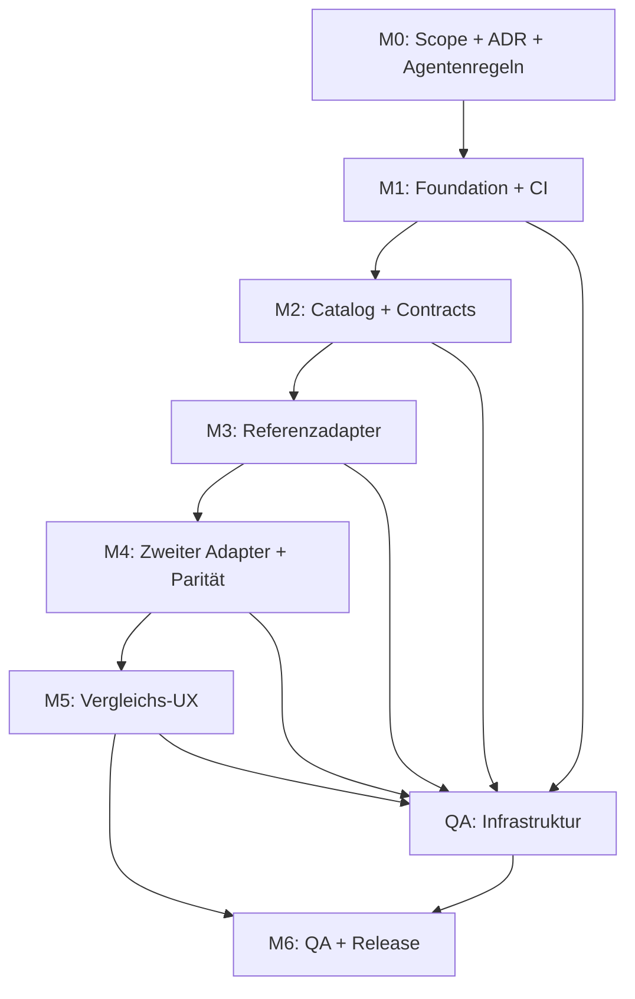

# Agentenorganisation und Orchestrierung

## Quelle und Übertragungsprinzip

Adaptiert aus [`kostuemwettbewerb/AGENTS.md`](https://github.com/derdigitalaffine/kostuemwettbewerb/blob/main/AGENTS.md) und [`kostuemwettbewerb/docs/ROADMAP.md`](https://github.com/derdigitalaffine/kostuemwettbewerb/blob/main/docs/ROADMAP.md): **eine Aufgabe pro Agent, explizite Verantwortung, sequenzielle Baseline, abgesicherte Übergaben, Tests und dokumentierte Entscheidungen**.

Die Quelle enthält in diesen Dateien **prozessuale Orchestrierung**, keine Agenten-Runtime. Auch hier ist dies zunächst ein Arbeitsprotokoll für menschliche und KI-Agenten; keine automatische Jobverteilung, kein Scheduler und keine bereits laufende Multi-Agent-Ausführung.

## Rollen und Verantwortlichkeit

| Rolle | Primäre Verantwortung | Artefakte | Nicht ohne Review ändern |
| --- | --- | --- | --- |
| **Orchestrator / Tech Lead** | Issues schneiden, Sequenz und Dependencies steuern, Konflikte lösen, Gates freigeben | Issue-Backlog, ADRs, PR-Freigaben | Kein Ersatz für Tests/Code-Review |
| **Foundation-Agent** | React-Projekt, Toolchain, Build, CI, Testinfrastruktur, Routing-Skelett | `package.json`, Build-/Lint-Konfiguration, `src/app/`, CI | Contracts und Adapter-Semantik |
| **Catalog/Contract-Agent** | Kanonische Komponenten, Zustände, Vergleichsdaten, Adapter-Interface | `src/catalog/`, `src/contracts/`, Contract-Tests | Framework-spezifisches Layout |
| **Framework-Adapter-Agent** | Komponentenimplementierung pro Bibliothek | `src/adapters/<library>/`, Adapter-Tests | Shared Core, andere Adapter |
| **Showcase/UX-Agent** | Katalognavigation, Filter, Suche, Gegenüberstellung, responsive Oberfläche | `src/showcase/`, User-Flows, UI-Tests | Adapter-Contracts ohne Abstimmung |
| **Security/Accessibility/QA-Agent** | Threat-/Dependency-Checks, A11y, Regression, Cross-Library-Parität, Abnahme | `tests/`, QA-Befunde, Review-Kommentare | Produktumfang stillschweigend ändern |
| **Release/Docs-Agent** | Nutzungsanleitung, Setup, Deployment-/Release-Checkliste | `README.md`, `docs/`, Release-Notizen | Laufzeitarchitektur ohne ADR |

Die Verzeichnisse sind **Zielstruktur**, noch kein existierender Code.

## Abhängigkeitsgesteuerter Ablauf



**Gates:**

- **G0 / Scope:** Mindestens zwei zu vergleichende Bibliotheken, Beispielset, Versions-/Lizenzstrategie und Stack als ADR akzeptiert.
- **G1 / Foundation:** App startet lokal; Build, Lint, Typecheck, Unit-Test und CI sind reproduzierbar.
- **G2 / Contracts:** Identische Props, Zustandsmatrix und erwartete Interaktionen sind festgelegt und getestet.
- **G3 / Referenz:** Erstes Framework erfüllt alle Pflichtfälle inklusive Keyboard und Mobile.
- **G4 / Parität:** Zweites Framework erfüllt dieselben Pflichtfälle; Unterschiede sind dokumentiert.
- **G5 / Experience:** Auswahl, Navigation, Seiten-an-Seiten-Vergleich, Deep Links und Empty/Error States funktionieren.
- **G6 / Release:** Automatisierte Checks und manuelle Abnahmematrix bestanden; bekannte Einschränkungen und Versionen veröffentlicht.

Ein Gate wird nur mit konkretem Nachweis freigegeben (PR-Link, Testlauf, QA-Bericht), nicht durch die Aussage eines Agenten.

## Reihenfolge, Parallelität und Handover

1. Orchestrator erstellt ein Issue mit Ziel, Rolle, Abhängigkeiten, Dateibereich und messbaren Kriterien.
2. Agent liest `AGENTS.md` und alle relevanten Spezifikationen; dokumentiert Konflikte **vor** der Implementierung.
3. Agent arbeitet auf eigenem Branch, implementiert minimal und ergänzt Tests; PR enthält Handover und Risiken.
4. QA prüft Produkt-/Contract-/Accessibility-Gates unabhängig, bevor Orchestrator merged.
5. Nach Merge wird das nächste abhängige Issue freigegeben; bei Contract-Änderung Regression auf allen Adaptern.

**Parallel erlaubt:** Dokumentation und QA-Infrastruktur parallel zur Foundation, nach G2 verschiedene Adapter in disjunkten `src/adapters/`-Ordnern, zusätzliche Story-/Testfälle ohne Änderung des Shared Core.

**Nicht parallel:** Schema/Contracts und Adapter-Implementierung vor G2; gleichzeitige Änderungen an Routing/Registry/Global Styles; finale UX-Integration vor G4.

## Issue-/Agent-Work-Package

Für jede Aufgabe diese Felder ausfüllen:

```md
## Ziel / Nutzerwert
## Priorität (P0/P1/P2) und verantwortliche Rolle
## Voraussetzungen und abhängige Issues
## Erlaubte Dateien / gesperrte Bereiche
## Erwartete Schnittstellen / Akzeptanzkriterien
## Tests (automatisch + manuell)
## Risiken, Lizenz-/A11y-/Security-Folgen
## Handover (PR, Testbelege, offene Punkte, Folge-Agent)
```

## Konflikt- und Eskalationsregeln

- Contract-Ambiguität: Catalog-Agent entwirft Vorschlag, Orchestrator entscheidet im ADR, danach Adapter aktualisieren.
- UI-Paritätskonflikt: Gleiches Zielverhalten priorisieren; echte Bibliotheksgrenzen transparent markieren.
- Build-/CSS-Konflikt: Foundation-Agent ist Owner der globalen Konfiguration; andere Agenten liefern Änderungen als isolierte PRs.
- QA-Sperre: Kritische Tastatur-, XSS-, Build- oder Paritätsfehler blockieren P0-Merge. Kein Umdeklarieren zu P2 ohne begründete ADR.
- Unklare Produktentscheidung: Entscheidung in `docs/DECISIONS.md` dokumentieren statt stillschweigend zu raten.

## Review- und Release-Rhythmus

- Pro PR: Verantwortlicher Agent → QA-Review → Orchestrator-Merge.
- Nach jedem Meilenstein: Änderungsumfang, Contract-Version, offene Risiken und Testbelege ins Handover.
- Vor Release: clean install, Production Build, automatisierte Tests, 320/360/768/1280-px-Browsercheck, Keyboard-/Screenreader-Smoke, Lizenzprüfung und dokumentierte Abweichungen.

## Was ausdrücklich nicht übertragen wird

Keine Django-, PostgreSQL-, Event-, Jury-, Medien- oder Einwilligungsworkflows aus dem Referenzprojekt. Die übernommenen Prinzipien betreffen **Arbeitsorganisation und Quality Gates**, nicht die fachliche Implementierung.
